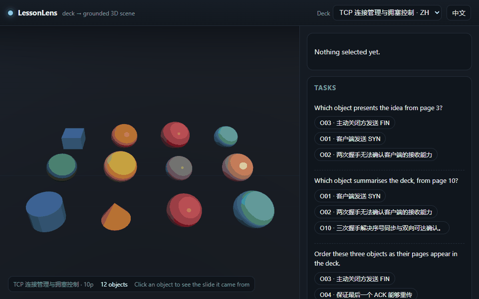
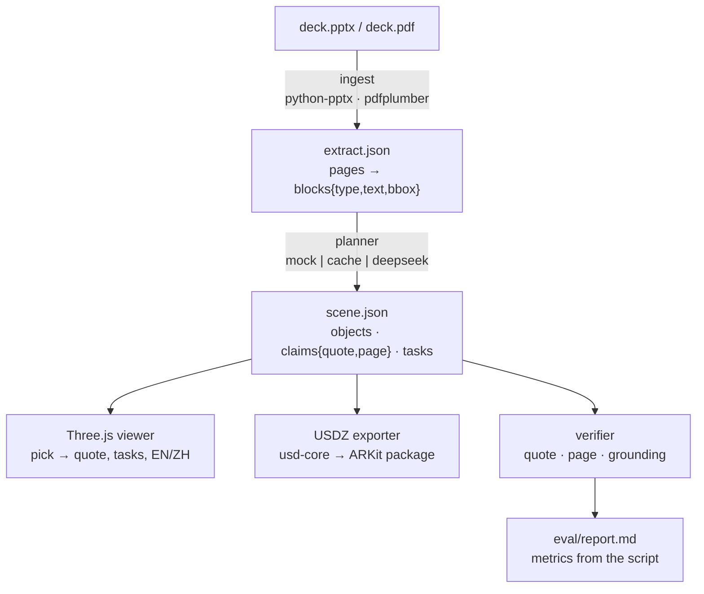

# LessonLens

**A slide deck becomes an interactive 3D scene where every object quotes the slide it came from —
and a generated report proves it.**

[](https://github.com/mbj733/lessonlens/actions/workflows/ci.yml)
[](https://mbj733.github.io/lessonlens/)
[](LICENSE)



*10-second loop recorded by `tools/make_demo.py`: orbit, pick two objects, answer a task, switch
language. No screen recorder, no hand editing.*

## Three numbers

| | | |
|---|---|---|
| **168 / 168** | claims traced to a verbatim sentence on the page they name | `quote_hit_rate 100%` |
| **126 / 126** | injected corruptions caught by the verifier (0 missed) | negative control, not a claim |
| **14 / 14** | USDZ packages passing the `usdchecker` engine, 0 errors, 0 warnings | ARKit-compliant |

Plus: 63 tests, CI green on every push, live at
<https://mbj733.github.io/lessonlens/>.

## How it works



`scene.json` is the only intermediate truth: viewer, exporter and evaluator all read it, and nothing
else.

## Why the grounding gate matters

An LLM will happily write *"quick sort is stable"* and cite page 4. The deck says the opposite.
LessonLens refuses to trust the model:

1. **Quote gate** — the quote, whitespace-normalised, must occur on the page the claim names.
2. **Page gate** — if it occurs, but elsewhere, the claim is `WRONG_PAGE` and the report says where.
3. **Grounding gate** — the claim sentence must be covered by its quote (token/CJK-bigram overlap),
   otherwise `UNGROUNDED`.

The gates are tested against themselves: `verify.self_test` scrambles a quote word, shifts a page and
replaces a claim sentence in copies of the real scenes — **126/126 caught**. Without that number,
"0 unsupported claims" would only prove the checker never looks.

## Reproduce

```powershell
python -m venv .venv
.venv\Scripts\python.exe -m pip install -e ".[dev,usd]"

.venv\Scripts\python.exe tools\gen_samples.py                    # 10 decks × 10 slides
.venv\Scripts\python.exe -m lessonlens ingest eval/slides --out eval/extract --root .
.venv\Scripts\python.exe -m lessonlens build  eval/slides --out eval/scenes  --root .
.venv\Scripts\python.exe -m lessonlens eval                     # → eval/report.md
.venv\Scripts\python.exe -m lessonlens export                   # → out/*.usdz + compliance report
.venv\Scripts\python.exe -m pytest -q                           # 63 tests
.venv\Scripts\python.exe -X utf8 tools\web_check.py             # real browser: 13/13
```

Open the viewer: `python -m http.server 8123` from the repository root, then
`http://127.0.0.1:8123/web/?scene=zh-09-tcp.pptx.json`.

## What is inside

| directory | contents |
|---|---|
| `src/lessonlens/` | `ingest.py` · `planner.py` · `verify.py` · `eval.py` · `export_usdz.py` · `cli.py` |
| `schema/scene.schema.json` | the scene contract (8–24 objects, claims with verbatim quote + page) |
| `web/` | viewer, i18n, vendored Three.js r187 (no build step) |
| `eval/slides/` | 10 self-authored decks, EN + ZH, 4 also rendered as PDF |
| `eval/scenes/` | 14 generated scenes (170 KB total) |
| `eval/report.md` | the metric table, regenerated on every run |
| `docs/` | per-batch evidence: what was run, what broke, what is still unverified |
| `tools/` | corpus generator, browser gate, demo recorder, USDZ probe |

## Honest limits

- **No device.** There is no iPhone, Vision Pro or macOS in this environment: the USDZ passes the
  compliance engine, but nothing was opened in Quick Look. The README says so instead of implying
  otherwise.
- **The default planner is a rule engine.** The mock provider cannot hallucinate, so its grounding
  metrics are perfect by construction; they become informative with `--llm deepseek`, whose adapter is
  unit-tested but was never called against the live API here (no key).
- **Scale is untested.** Ten-slide decks only; a 200-slide deck or a scanned PDF (no text layer) has
  code paths (`text_layer=false`) but no corpus.
- **Lexical, not semantic.** A paraphrase sharing no tokens with its quote is marked `UNGROUNDED` —
  a deliberate false-negative bias.

## Evidence trail

Each batch ships with the command output that justified it, including the defects found on the way
(three of them were silent data-loss bugs):

| doc | what it records |
|---|---|
| [`docs/b0-evidence.md`](docs/b0-evidence.md) | environment, dependency versions, why `usd-core==25.11` is pinned |
| [`docs/b1-evidence.md`](docs/b1-evidence.md) | corpus hashes, ingest statistics, three data-loss bugs |
| [`docs/b2-evidence.md`](docs/b2-evidence.md) | scene validation, determinism, four defects |
| [`docs/b3-evidence.md`](docs/b3-evidence.md) | browser gate 13/13, first-paint number, CDN deviation |
| [`docs/b4-evidence.md`](docs/b4-evidence.md) | three gates, metric table, the negative-control harness |
| [`docs/b5-evidence.md`](docs/b5-evidence.md) | USDZ export, packaging defects, device-verification limit |
| [`docs/b6-evidence.md`](docs/b6-evidence.md) | demo media, publishing, live checks, CI run |

## Live

| what | where |
|---|---|
| viewer | <https://mbj733.github.io/lessonlens/> |
| metric table | <https://mbj733.github.io/lessonlens/eval/report.md> |
| sample USDZ (12 KB) | <https://mbj733.github.io/lessonlens/out/zh-09-tcp.pptx.usdz> |
| CI | <https://github.com/mbj733/lessonlens/actions> |
| release | <https://github.com/mbj733/lessonlens/releases/tag/v0.1.0> |

MIT licensed. Built on Windows without macOS, Xcode, a GPU compute box or an API key.
