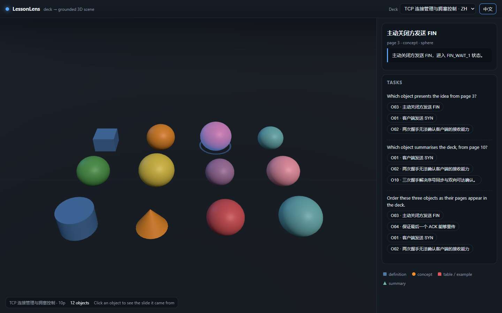

# LessonLens

**Slide deck in, grounded interactive 3D scene out.** An LLM proposes scene objects; every claim is
checked back against the source slide text, and the pass/fail table is produced by a script — not
typed by hand.

> Status: **B0 (environment), B1 (ingest), B2 (planner) and B3 (web runtime) done.** Verification,
> evaluation and USDZ export land in B4–B6.



Click an object, read the slide it came from. The screenshot above is produced by
`tools/web_check.py`, which also asserts the click → quote path in a real browser.

## Pipeline

```
slide.pptx / .pdf
   │  ingest  (python-pptx / pdfplumber)          ← implemented
   ▼  extract.json   pages[] → blocks{type,text,bbox,rows}
   │  planner (schema-constrained; mock | cache | deepseek)   ← implemented (mock default)
   ▼  scene.json     objects[] / interactions[] / tasks[]  each object has claims{text,quote,page}
   ├─► web/        (Three.js viewer, pick → quote, tasks, EN/ZH)   ← implemented
   ├─► export_usdz (usd-core)  ─► out/scene.usdz ─► usdchecker
   └─► verify + eval           ─► eval/report.md
```

`scene.json` is the only intermediate truth: the renderer, the USDZ exporter and the evaluator read
it and nothing else.

## Quick start (Windows)

```powershell
python -m venv .venv
.venv\Scripts\python.exe -m pip install -e ".[dev]"

# regenerate the evaluation corpus (writes eval/slides + eval/expected/manifest.json)
.venv\Scripts\python.exe tools\gen_samples.py

# deck -> extract JSON
.venv\Scripts\python.exe -m lessonlens ingest eval/slides --out eval/extract --root .

# extract -> scene JSON (mock planner: deterministic, no API key)
.venv\Scripts\python.exe -m lessonlens build eval/slides --out eval/scenes --root . --llm mock

# browser gate: real Edge, real raycast click, screenshot
.venv\Scripts\python.exe -X utf8 tools\web_check.py

# gates
.venv\Scripts\python.exe -m ruff check .
.venv\Scripts\python.exe -m pytest -q
```

Open the viewer with a static server from the repository root (scenes are fetched from
`../eval/scenes/`, so `file://` will not work):

```powershell
.venv\Scripts\python.exe -m http.server 8123
# then http://127.0.0.1:8123/web/?scene=zh-09-tcp.pptx.json
```

## Evaluation corpus

Ten self-authored 10-slide decks (5 English, 5 Chinese), generated from `tools/sample_corpus.py`.
Four of them are also rendered to PDF so both ingestion paths run on the same text. No third-party
slide content is involved, and page numbers line up across formats: page *n* of the PDF is slide *n*
of the PPTX.

| deck | lang | pages | topic |
|---|---|---|---|
| `en-01-sorting` | en | 10 | merge/quick/heap sort, complexity table |
| `en-02-bst` | en | 10 | BST operations, balancing, cost table |
| `en-03-hashing` | en | 10 | chaining, open addressing, load factor, table |
| `en-04-shortest-paths` | en | 10 | BFS, Dijkstra, Bellman-Ford, A* |
| `en-05-processes-threads` | en | 10 | processes vs threads, IPC, deadlock |
| `zh-06-binary-tree` | zh | 10 | 二叉树性质、四种遍历、还原、复杂度表 |
| `zh-07-dp` | zh | 10 | 状态设计、背包、LCS、优化方向 |
| `zh-08-db-normalization` | zh | 10 | 函数依赖、1NF–BCNF、B+ 树索引、范式表 |
| `zh-09-tcp` | zh | 10 | 三次握手、四次挥手、拥塞控制、状态表 |
| `zh-10-backprop` | zh | 10 | 前向/反向传播、链式法则、常见问题 |

## Ingest output

`python -m lessonlens ingest` writes one JSON per input file (`eval/extract/<file>.json`). Block
types are `title`, `bullet`, `body`, `table` (with structured `rows`) and `image`. Every block keeps
its geometry: exact shape boxes for PPTX, line boxes for PDF.

## Scene contract

`schema/scene.schema.json` (JSON Schema 2020-12) fixes the shape: 8–24 objects, each with a
`primitive` (`box|sphere|cylinder|cone|plane`), a position, a colour and at least one claim carrying
a **verbatim** `quote` and its `page`; one click interaction per object; 1–8 tasks whose answers point
at object ids. `validate_scene()` adds the rules JSON Schema cannot express — cross references, page
range, and a 60k triangle budget.

The default planner is a deterministic rule engine (`--llm mock`) that maps one object per slide,
so every number in this repository can be reproduced without a key. `--llm cache` replays committed
JSON; `--llm deepseek` calls the API (adapter implemented, **not exercised against the live service**
in this environment — no key available).

## Limitations

- No macOS / Xcode / Vision Pro here: spatial output is proven with **USDZ + `usdchecker`**, not a
  device build. Anything not verified on hardware is labelled as such.
- The default planner will be **deterministic mock**; no API key is needed to reproduce every number.
- Ingest does **no OCR**: a scanned PDF page yields zero blocks and is flagged `text_layer=false`.
- `usdchecker` ships no Windows binary; the same `UsdUtils.ComplianceChecker` engine is used instead
  (see `docs/b0-evidence.md`).

## Evidence

- `docs/b0-evidence.md` — environment, dependency versions, USDZ validator probe
- `docs/b1-evidence.md` — corpus hashes, ingest statistics, test results, design notes
- `docs/b2-evidence.md` — scene validation, planner determinism, the four defects fixed
- `docs/b3-evidence.md` — browser gate (13/13), first-paint number, UI defects fixed, CDN deviation
